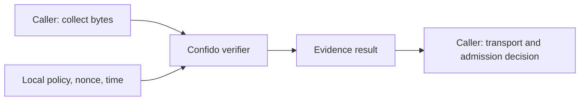

# Confido 0.2

Confido is a portable **evidence verifier**. It accepts bytes, locally selected
policy, an independent expected nonce and explicit evaluation time. It returns an
`evidence_only` result. It opens no connection and creates no application session.

The supported `azure-snp-vtpm-ima/1` profile checks an AMD-signed report from
an Azure confidential VM, links it to a virtual TPM quote, and compares the
measured boot and kernel-module state with caller-approved reference values.
The [security model](docs/security-model.md) explains the trust chain, roles,
terminology, and limits for reviewers new to TEE attestation. The wire-v1
certificate/IMA binding is specified by the shared Evidence protocol.



## Packages

| Directory | Responsibility |
|---|---|
| [Evidence](https://github.com/teraveri/evidence) | Shared Git source pinned by the Cargo manifests and lockfiles |
| [Evidence protocol](https://github.com/teraveri/evidence/tree/main/protocol) | Wire v1 structures and binding transcript |
| [Evidence core](https://github.com/teraveri/evidence/tree/main/core) | Shared SNP/HCL/quote parsing and collected-snapshot consistency checks |
| [`lib/`](lib/README.md) | Portable synchronous verifier, policy and reference appraisal |
| [`bindings/python/`](bindings/python/README.md) | `confido-verifier` distribution / `confido_verifier` import |
| [`bindings/wasm/`](bindings/wasm/README.md) | Same verifier compiled to WASM |
| [`client/`](client/README.md) | HTTP collection, explicit verification and historical replay |
| [`extension/`](extension/README.md) | Local WASM worker, policy import, archive replay, permitted live retrieval |

The chat application's native TLS transport lives in the sibling
`confidential-ai-example/native_transport`, independently of this library.
Build and acceptance helpers are indexed in [`scripts/`](scripts/README.md).
[JAN Attestor](https://github.com/jandigitrust/attestor) owns native collection
and the challenge-bound `/tee-report` endpoint. Callers select the HTTPS origin
and verifier policy locally; Attestor does not choose trust anchors.

## Build and test

Rust 1.98.0 and Cargo locks are pinned. Cargo fetches both Evidence crates
directly from the public Teraveri Git repository at commit
`900d420b0928c4693e1143aa33a33ab670147e3c`; no sibling checkout is
needed. Each Confido package has its own lockfile and pins that same source.
The verifier uses `ring` and a bounded X.509 profile; its runtime requires neither
OpenSSL nor TPM2-TSS. `ring` compiles portable C with clang for WASM. OpenSSL is used
only in native verifier test fixtures. Attestor and application transport have
their own native dependencies.

```sh
cargo test --locked --manifest-path lib/Cargo.toml
cargo build --locked --manifest-path client/Cargo.toml
python3 -m venv .venv
. .venv/bin/activate
python -m pip install 'maturin==1.15.0' jsonschema
make -C bindings/python install PYTHON=python
python -m unittest discover -s lib/tests -v
python -m unittest discover -s tests -v
```

The Evidence repository runs its own workspace tests in CI; Confido's locked
builds test the imported crates through their consumers.

Native test fixtures compile vendored OpenSSL. Attestor documents its separate
TPM2-TSS build prerequisites.
The PyPI workflow is configured for CPython 3.10/3.13 on Linux x86_64 and
CPython 3.13 on macOS arm64/x86_64. Each artifact still needs its own CI and
consumer acceptance before publication.

## Python API

```python
import confido_verifier

result = confido_verifier.verify(
    report=report_bytes,
    amd_chain=ask_plus_ark_pem,
    vcek=vcek_der,
    reference=exact_reference_bytes,
    policy=local_verifier_policy_bytes,
    expected_nonce=caller_nonce_32_bytes,
    evaluation_time=caller_unix_seconds,
)
```

`inspect_requirements(report_bytes)` returns **untrusted** chip/TCB selectors for
caller-owned KDS retrieval. It never fetches anything. Invalid policy/context or
outer size limits raise `ValueError`; evidence rejection is a structured result.
The Rust API has the same inputs via `VerificationInput` and `VerificationContext`.
The WASM wrapper accepts `Uint8Array` inputs and returns a JSON string.

## CLI

```sh
client/target/debug/confido-cli collect ../confidential-ai-example/profiles/match.json /private/new-archive.json
client/target/debug/confido-cli appraise ../confidential-ai-example/profiles/match.json /private/new-run.json
client/target/debug/confido-cli verify ../confidential-ai-example/profiles/verifier-match.json archive.json EXPECTED_NONCE_BASE64 UNIX_SECONDS
client/target/debug/confido-cli replay ../confidential-ai-example/profiles/verifier-match.json archive.json UNIX_SECONDS
client/target/debug/confido-cli migrate-archive old-v1.json new-v2.json UNIX_SECONDS
```

`appraise` collects and verifies evidence only. `replay` deliberately uses a
historical archived nonce; neither command grants live application access.
The paths above are GENXT demo policies owned by `confidential-ai-example`;
Confido consumes caller-supplied policy bytes and does not own their trust pins.
Those default application profiles target the original Milan demo. For the
current Genoa test VM, use the explicit stage policies in the
[local acceptance checklist](docs/revision/rerun.md).
Archives are created exclusively with mode 0600. Raw report/reference bytes are
preserved in schema v2. CLI accepts legacy archives through its caller-side adapter.

## Browser extension

See [extension build and install](extension/README.md). Verification runs entirely
inside its packaged WASM worker, with no native helper or remote verifier.
Live retrieval uses only origins explicitly supplied at build time, plus AMD KDS
and GitHub. Without an origin list, the extension supports local replay only.
Local replay does not need host permissions. Safari packaging requires
macOS/Xcode and is not certified by Linux browser tests.

## Assurance boundary

A matched challenge does not itself establish freshness. The caller owns nonce
creation, deadlines and reuse prevention. A certificate-bound quote does not
prove that certificate belongs to the observed TLS connection. **TLS session
binding and relay resistance are unsupported.** Native callers must authenticate
their actual peer separately before credentials or prompts.

The enrolled reference covers boot aggregate/kernel modules, not applications,
models, GPU state or external inference. The TCB floor and launch measurement are
operator enrollments, not vulnerability-free certification. Revocation/advisory
updates are not fetched by the verifier. AMD chain validation supports this fixed
profile, not general-purpose PKIX path discovery.

See the [documentation index](docs/README.md), [schema catalog](schemas/README.md)
and [third-party notices](THIRD_PARTY_NOTICES.md).

## Origin and licence

Confido began as
[GENXT's attested TLS prototype](https://github.com/elixir-cloud-aai/generic-issues/issues/17).
The [licensing issue](https://github.com/genxnetwork/confido/issues/8) records its
move to open development and the plan for [JAN DIGITRUST](https://github.com/jandigitrust/confido)
to develop the verifier for contribution upstream. Project-authored material is
licensed under [Apache-2.0](LICENSE); third-party material retains its original terms.

## Related work

Related work on formal security analysis and programmatic trust management is
underway through the [GA4GH GIF TRE Open Suite](https://www.ga4gh.org/gif_project/tre-open-suite/).
